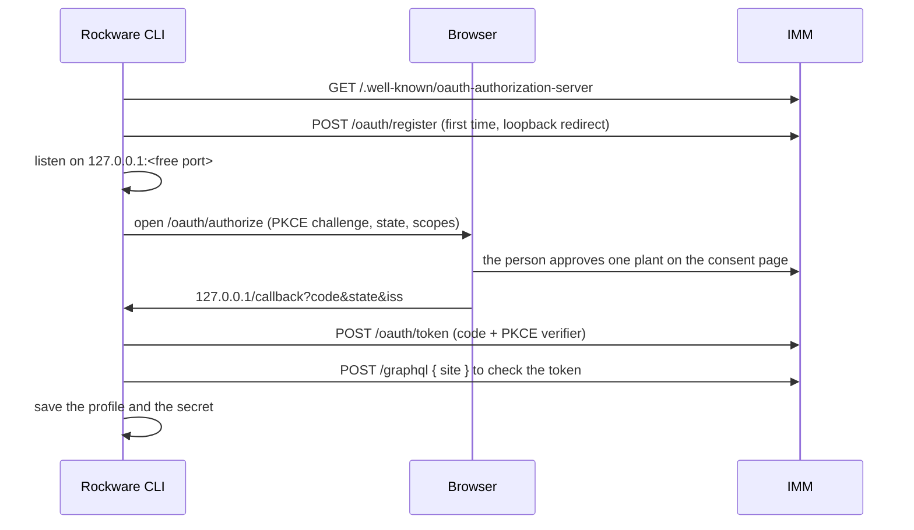

# How the Rockware CLI works

The Rockware CLI (`rw`) is Rockware on the command line. Every command calls the [developer API](https://platform.rockwarecorp.com/api/graphql/) at `/graphql`, on your Rockware host.

| What | Where |
| --- | --- |
| Entry point, exit codes | `src/main.ts`, `src/errors.ts` |
| The command tree | `src/program.ts`, `src/commands/` |
| Every query the CLI sends | `src/api/queries.ts` |
| Calling `/graphql` and its failures | `src/api/client.ts` |
| Answers: envelope, JSON or text | `src/output.ts`, `src/format.ts` |
| Profiles and hosts | `src/config.ts`, `src/session.ts` |
| Secrets: keychain or file | `src/credentials.ts` |
| Browser sign-in, refresh | `src/oauth.ts` |
| Builds and releases | `scripts/compile.ts`, `scripts/formula.ts`, `install.sh`, `.github/workflows/release.yml` |
| Tests | `test/` |
| The API's schema | `schema/developer-api.graphql` |

## Commands

Commands are `rw <noun> <verb>`. A noun on its own shows its help.

- `auth login | status | logout`, and `profile list | use | remove`
- `site`
- `<records> list | show <id>` for `workcenters`, `stations`, `jobs`, `tools`, `products`, `materials`, `customers`, `orders`, `production-runs`
- `workcenters | stations | materials | products | tools | jobs | customers | orders | production-runs upsert [file]`, matched by `externalId`
- `lineup show <station-id> | sequence <station> <runs...>`
- `entities list | show <key> | upsert [file]` and `entity-records list <model> | show <id> | upsert <model> [file]`: custom entities, in one general shape
- `webhooks list | events | create | update | delete | rotate-secret | test | deliveries | redeliver`
- `api <query>`: any GraphQL, for what the named commands don't cover
- `doctor`, `commands`, `completion bash|zsh|fish`

`rw commands --json` lists all of them, with their arguments and flags.

**To add a kind of record**, add it to `RECORD_KINDS` in `src/api/queries.ts`. It gets `list` and `show`, under `command` if its group name isn't the query's (`production-runs`). **To add a write**, add its mutation to `queries.ts` and its command next to the others in `src/commands/writes.ts` (most are one `batch(...)` line). Then run the tests. The schema test checks the new query, and the surface test asks you to update `surface.txt`.

## Answers

Every command returns a `Result`: `data`, a one-line `summary`, and `breadcrumbs` (the commands that make sense next).

- **In a terminal:** a table or a list of fields, the summary, and "Next:".
- **Piped, or `--json`:** `{ ok: true, data, summary, breadcrumbs }`.
- **`--quiet`:** the data alone.
- **Failures:** `{ ok: false, error, code, retryable, hint, details }`. In JSON mode this goes to stdout, so whatever reads the answer gets it. In a terminal, it goes to stderr.

Each `code` has its own exit code: `usage` 2, `not_found` 3, `auth` 4, `forbidden` 5, `rate_limited` 6, `network` 7, `api` 8, `validation` 9, anything else 1. Retry when `retryable` is true, not by reading the code. An upsert's field errors come back in `details`, with exit 9.

These are a contract. Add a code; never change one.

## Signing in

A **profile** is one host and one plant. `--host acme` means `https://acme-api.rockware.io`. http is allowed only for localhost. The profile is `-P`, else `RW_PROFILE`, else the default, else the only one. `RW_TOKEN` plus `RW_HOST` runs without a saved profile.

**Through the browser** (`rw auth login`), with the OAuth that Rockware's server (IMM) has for agents:

- The CLI checks `state` and `iss` before using the code.
- It asks for `data:read`, or with `--scope write` also `data:write` and `webhooks:write`. Anyone who can see the plant may give reads; writes need a plant admin. If the grant is smaller than asked, the CLI says so.
- The access token lasts 15 minutes. The CLI refreshes it a minute early, or after a `401`. Refresh tokens rotate, so a lock folder (`<config>/locks/<profile>.lock`) lets one copy of the CLI refresh at a time.
- `rw auth logout` revokes the grant on the server, then forgets the secret.

**With an API token** (`--with-token`): the CLI reads it from stdin, never from an argument, and checks it before saving.

`--expect-site <id>` refuses to save a sign-in for any other plant.

**Secrets** go to the macOS Keychain (`security`) or the Linux Secret Service (`secret-tool`), on stdin. When there's neither, or the keychain fails, they go to `credentials.json`, which only you can read. `RW_NO_KEYRING=1` always uses the file. Settings live in `config.json` in `RW_CONFIG_DIR`, else `$XDG_CONFIG_HOME/rw`, else `~/.config/rw`.

## Builds and releases

`bun build --compile` puts Bun's runtime and the CLI in one file. `pnpm compile:all` builds every platform into `dist/release`: `rw-<version>-<os>-<arch>.tar.gz` (a `.zip` for Windows), plus `checksums.txt`. Each archive holds `rw`, `LICENSE` and `THIRD_PARTY_NOTICES`.

To release:
1. Bump the version in `package.json` and `src/version.ts`. A test keeps them the same.
2. Merge, then push the tag `v<version>`.

`release.yml` then tests, builds, and publishes:
- a GitHub release here, with `install.sh`, `LICENSE` and `THIRD_PARTY_NOTICES`;
- `Formula/rw.rb` on `rockwarehq/homebrew-tap`.

The release uses this repo's own token. Updating the tap needs the `HOMEBREW_TAP_TOKEN` secret; without it, the tap is left alone.

`install.sh` checks the download's SHA-256 against `checksums.txt` before installing.

## Testing

`pnpm test` needs no database or network:
- `schema.test.ts`: every query against `schema/developer-api.graphql`;
- `surface.test.ts`: the commands and flags against `surface.txt`;
- `oauth.test.ts`: the browser sign-in and API failures, against a small fake server;
- `output.test.ts` and `session.test.ts`: answers, exit codes, profiles, secrets;
- `commands.test.ts`: commands end to end against a fake `/graphql`: what each sends, and what it answers.

## The schema

`schema/developer-api.graphql` is a copy of the developer API's schema. Rockware's server CI runs `schema.test.ts` against its own current schema too (with `RW_SCHEMA` pointing at it), so an API change that would break the CLI is caught there. When the API gains something the CLI should use, Rockware updates this copy first, then the command.
